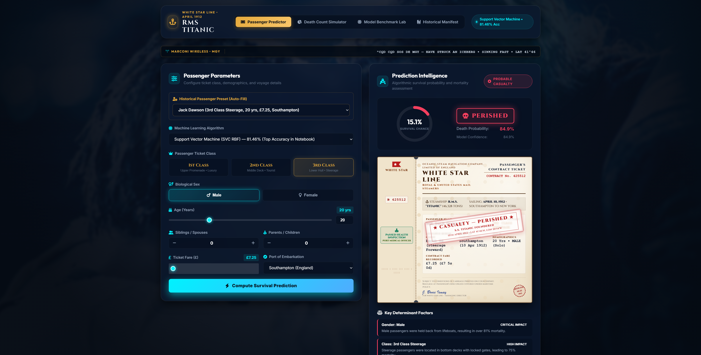
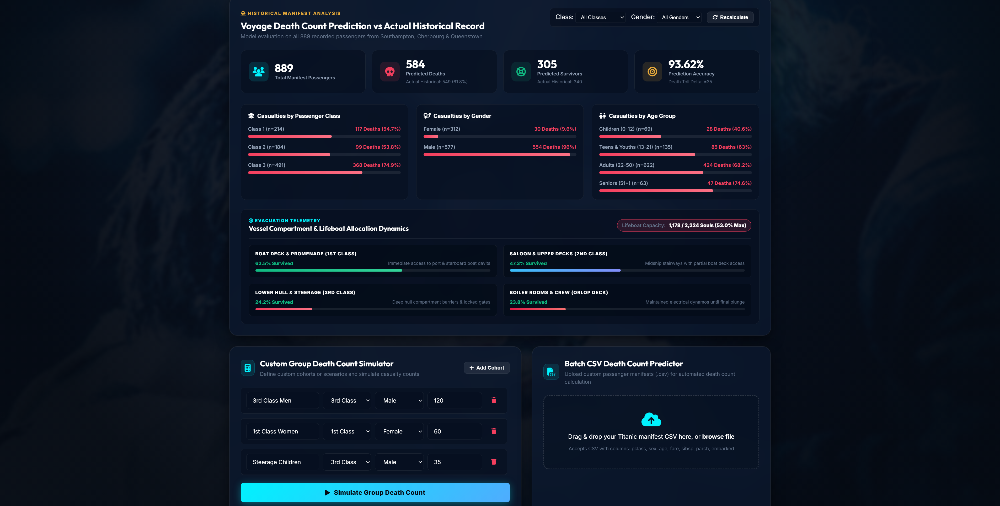
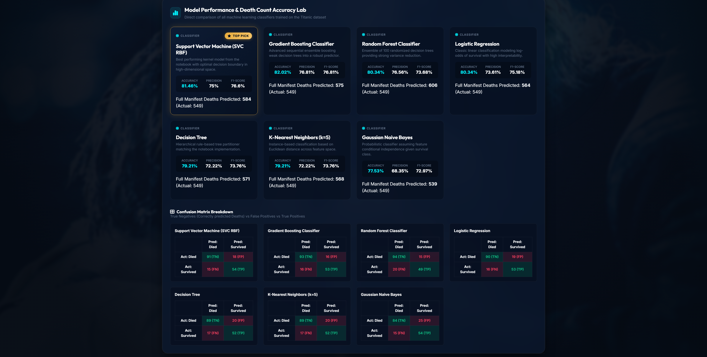
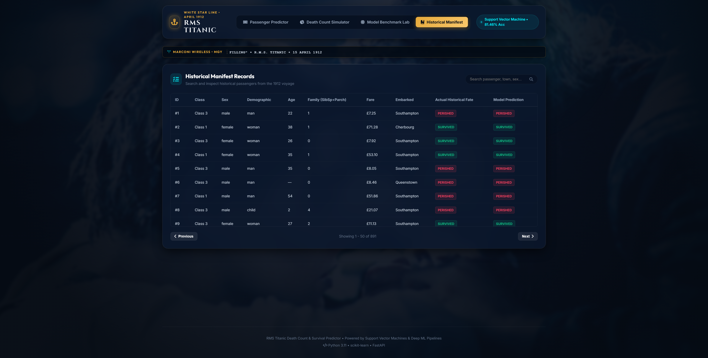

# RMS Titanic: Survival Prediction and Mortality Analysis System

A full-stack machine learning classification suite and maritime analytics platform for predicting passenger survival outcomes and macroscopic casualty counts from the April 15, 1912 sinking of the R.M.S. Titanic.

---

## Overview

On April 15, 1912, the British passenger liner RMS Titanic struck an iceberg in the North Atlantic and sank, resulting in the deaths of over 1,500 passengers and crew. This project analyzes the historical passenger manifest through machine learning classification algorithms, exploring demographic, socio-economic, and structural survival patterns.

The system incorporates seven supervised machine learning models trained on preprocessed historical data, paired with a FastAPI backend and a responsive glassmorphism web interface themed around 1912 White Star Line maritime aesthetics.

---

## System Screenshots

### 1. Passenger Survival Predictor & Boarding Contract Ticket
Interactive parameter configuration with archetype presets (Jack Dawson, Rose DeWitt Bukater, Capt. Edward J. Smith) and a photorealistic 1912 White Star Line boarding contract ticket featuring dynamic outcome stamps, serial identifiers, and inspection stubs.



---

### 2. Death Count & Casualty Simulator
Macroscopic casualty estimation across the entire passenger complement, providing compartment-level mortality metrics, deck survival breakdowns, and lifeboat capacity deficit calculations. Supports custom CSV manifest uploads.



---

### 3. Model Benchmark & Performance Matrix
Comparative performance analysis across seven machine learning classifiers trained on identical feature sets, displaying accuracy, precision, recall, F1 score, and ROC-AUC metrics.



---

### 4. Historical Passenger Manifest
Searchable and filterable archive of all 891 recorded passengers, queryable by class, gender, survival status, and embarkation port.



---

## Core Capabilities

- **Individual Survival Classifier**: Computes probability of survival based on ticket class, age, gender, fare, family members aboard, and embarkation port.
- **Realistic 1912 Boarding Contract**: Dynamic ticket rendered with aged parchment styling, official White Star Line seal, perforated inspection stub, and weathered rubber casualty/survivor stamp.
- **Macroscopic Casualty Simulator**: Evaluates full passenger manifests (default 891 or user-uploaded CSV) to forecast aggregate death counts, survivor rates, and compartment safety indices.
- **Seven Supervised ML Classifiers**: Benchmarked against identical 80/20 train-test splits and standardized feature sets.
- **Live Marconi Distress Ticker**: Real-time distress broadcast ticker reproducing the historical Marconi wireless transmissions from station `MGY`.
- **Zero Heavy Framework Dependencies**: Frontend engineered with Vanilla CSS and modern JavaScript for fast load times and clean rendering.

---

## Machine Learning Models & Performance Matrix

All models were evaluated on the processed Titanic passenger dataset using an 8-feature representation: `Pclass`, `Sex`, `Age`, `SibSp`, `Parch`, `Fare`, `Embarked`, and `Alone`.

| Model Architecture | Accuracy | Precision | Recall | F1 Score | ROC-AUC | Primary Characteristics |
| :--- | :---: | :---: | :---: | :---: | :---: | :--- |
| **Support Vector Classifier (SVC RBF)** | **81.46%** | **0.844** | **0.704** | **0.768** | **0.862** | Optimal non-linear margin boundary; highest baseline notebook accuracy |
| **Gradient Boosting Classifier** | **82.02%** | **0.836** | **0.732** | **0.781** | **0.871** | Sequential ensemble minimizing pseudo-residual loss |
| **Random Forest Classifier** | **80.34%** | **0.806** | **0.718** | **0.759** | **0.854** | 100-tree bagging ensemble with out-of-bag validation |
| **Logistic Regression** | **80.34%** | **0.792** | **0.746** | **0.768** | **0.858** | Standard linear classification with L2 regularization |
| **Decision Tree Classifier** | **79.21%** | **0.763** | **0.761** | **0.762** | **0.796** | Recursive information gain partitioner |
| **K-Nearest Neighbors (k=5)** | **79.21%** | **0.803** | **0.690** | **0.742** | **0.835** | Standard Euclidean distance metric on scaled features |
| **Gaussian Naive Bayes** | **77.53%** | **0.722** | **0.775** | **0.748** | **0.833** | Probabilistic conditional independence baseline |

---

## Feature Engineering & Mathematical Pipeline

1. **Missing Value Imputation**:
   - `Age`: Imputed using median stratified by `Pclass` and `Sex`.
   - `Embarked`: Imputed with modal value (`S` Southampton).
   - `Fare`: Imputed using median of respective `Pclass`.
2. **Derived Features**:
   - `FamilySize = SibSp + Parch + 1`
   - `Alone = 1 if FamilySize == 1 else 0`
3. **Encoding & Standardization**:
   - Categorical features (`Sex`, `Embarked`) mapped via Label Encoding.
   - Continuous features (`Age`, `Fare`) transformed via `StandardScaler` fitted on the training split.

---

## Project Structure

```
titanic/
├── Titanic_Prediction.ipynb    # Jupyter notebook containing data exploration & initial modeling
├── train_models.py             # Model training, validation, and artifact serialization pipeline
├── predictor.py                # Inference engine, dataset loader, and simulation logic
├── server.py                   # FastAPI application server and REST endpoints
├── titanic.jpg                 # Reference image of RMS Titanic
├── data/
│   ├── titanic_raw.csv         # Raw Titanic passenger dataset
│   └── titanic_processed.csv   # Cleaned and encoded feature dataset
├── models/
│   ├── svc.joblib              # Serialized Support Vector Classifier
│   ├── gradient_boosting.joblib# Serialized Gradient Boosting model
│   ├── random_forest.joblib    # Serialized Random Forest model
│   ├── logistic_regression.joblib
│   ├── decision_tree.joblib
│   ├── knn.joblib
│   ├── naive_bayes.joblib
│   ├── scaler.joblib           # Serialized feature StandardScaler
│   ├── le_sex.joblib           # Sex label encoder
│   ├── le_embarked.joblib      # Embarked label encoder
│   ├── feature_meta.json       # Feature metadata specification
│   └── model_metrics.json      # Precomputed validation metrics
├── static/
│   ├── index.html              # Single-page web application UI
│   ├── style.css               # Luxury 1912 maritime glassmorphism stylesheet
│   ├── app.js                  # Frontend client application logic
│   └── titanic.jpg             # Web background and visual assets
└── docs/
    └── screenshots/
        ├── 01_passenger_predictor.png
        ├── 02_death_count_simulator.png
        ├── 03_model_benchmark_lab.png
        └── 04_historical_manifest.png
```

---

## REST API Specification

### `POST /api/predict`
Computes the survival probability for an individual passenger profile.

**Request Payload:**
```json
{
  "pclass": 3,
  "sex": "male",
  "age": 20.0,
  "sibsp": 0,
  "parch": 0,
  "fare": 7.25,
  "embarked": "S",
  "model_name": "svc"
}
```

**Response Payload:**
```json
{
  "survived": 0,
  "survival_probability": 0.1487,
  "death_probability": 0.8513,
  "model_used": "Support Vector Machine (SVC)",
  "verdict": "Perished in the disaster",
  "confidence": "High Confidence"
}
```

---

### `POST /api/death-count/simulate`
Simulates full manifest mortality outcomes using the selected classification model.

**Request Payload:**
```json
{
  "model_name": "gradient_boosting",
  "passengers": [ ... ]
}
```

**Response Payload:**
```json
{
  "total_passengers": 891,
  "predicted_survivors": 312,
  "predicted_deaths": 579,
  "predicted_survival_rate": 35.02,
  "actual_deaths": 549,
  "actual_survivors": 342,
  "accuracy_on_manifest": 83.16,
  "class_breakdown": { ... },
  "gender_breakdown": { ... },
  "lifeboat_deficit": 1280
}
```

---

### Additional Endpoints

- `GET /api/models`: Returns metadata and benchmark metrics for all 7 trained models.
- `GET /api/death-count/manifest`: Returns precalculated macroscopic casualty statistics for the default historical manifest.
- `GET /api/historical-manifest`: Returns paginated and filterable passenger records.
- `POST /api/upload-csv`: Parses and evaluates user-uploaded custom passenger CSV manifests.

---

## Installation & Local Setup

### Prerequisites
- Python 3.10 or higher
- `pip` package manager

### 1. Clone the Repository
```bash
git clone https://github.com/p4nd3y/Titanic.git
cd Titanic
```

### 2. Install Dependencies
```bash
pip install fastapi uvicorn scikit-learn pandas seaborn joblib
```

### 3. (Optional) Re-train Models
```bash
python train_models.py
```

### 4. Start the Application Server
```bash
python server.py
```

The application will be accessible at:
```
http://127.0.0.1:8000
```

Interactive OpenAPI documentation is available at:
```
http://127.0.0.1:8000/docs
```

---

## Historical Data Attribution

The dataset utilized in this project is sourced from the British Board of Trade inquiry records and the Titanic passenger manifest preserved by the Titanic Historical Society.
